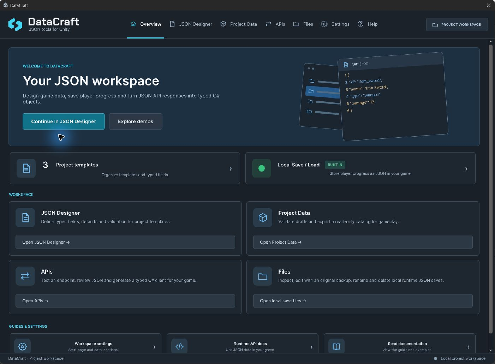

# DataCraft — documentation and release information

**Design game data, save player progress and use JSON APIs in Unity.**

**DataCraft 1.4.0 is currently announced for itch.io.** The signed channel governs actual download availability. Unity Asset Store remains pending its separate review.

[Start here: user documentation](docs/guides/index.md) · [Installation](docs/INSTALLATION.md) · [Release notes](docs/CHANGELOG.md) · [Support](docs/SUPPORT.md)

## Find your next step

| Goal | Guide |
| --- | --- |
| Get started with two weapons and a catalog | [First catalog walkthrough](docs/guides/UserGuide.md) |
| Define typed fields and instance drafts | [Templates and instances](docs/guides/Authoring.md) |
| Query read-only gameplay definitions | [Project Data](docs/guides/ProjectData.md) |
| Import a spreadsheet or move linked templates | [Import and export](docs/guides/ImportExport.md) |
| Save progress or inspect a local file | [Local saves and Files](docs/guides/SavesAndFiles.md) |
| Use an HTTP JSON service | [API workflow](docs/guides/HttpApi.md) |
| Update your official purchase | [Updates by store](docs/guides/Updates.md) |
| Diagnose a problem | [Troubleshooting](docs/guides/Troubleshooting.md) |

## Documentation and downloads

These public guides cover prepared **DataCraft 1.4.1**: Table/bulk editing, native instance Undo/Redo, the guided Catalog Starter and the models/Inspector improvements from the internal 1.3 milestone. **1.4.1 is not yet announced as downloadable in a store.** Customers with an earlier version should use their included offline manual or update when their store offers it. Documentation and store downloads follow separate publication schedules. Real Unity screenshots use example projects; names/counts are not automatically installed content.

This repository contains user documentation, public signed release metadata and publisher tools. It contains **no commercial package source, customer data or downloadable asset archive**. Obtain the asset/update through your purchase store. Retail editions follow their own store's entitlement and availability; a pending Unity review is not an approved downloadable release.

[Official itch.io page](https://albjav12345.itch.io/datacraft) · [Compatibility](docs/guides/Compatibility.md) · [Runtime API reference](docs/guides/ApiReference.md)

Questions, bugs or feedback: **[amedina.amg.dev@gmail.com](mailto:amedina.amg.dev@gmail.com)**.

Publisher maintenance is documented separately in [PUBLISHING.md](PUBLISHING.md). Documentation-only commits do not change signed notices or announce a new package.

Prepared 1.4 devlog text: [English](docs/devlogs/DEVLOG-ITCH-1.4.0.md) · [Español](docs/devlogs/DEVLOG-ITCH-1.4.0-ES.md). These notes do not change signed store availability.

Presentation review, 2026-10-30: prepared 1.4.0 documentation now shows the quieter Table icons, grouped navigation, contextual bulk controls and refreshed real Unity captures. This revision does not announce a store download.

Prepared **1.4.1** refines the aligned Table grid, uniform row backgrounds and Cards-style page buttons. Its store availability is not announced yet. Devlog drafts: [English](docs/devlogs/DEVLOG-ITCH-1.4.1.md) · [Español](docs/devlogs/DEVLOG-ITCH-1.4.1-ES.md).
