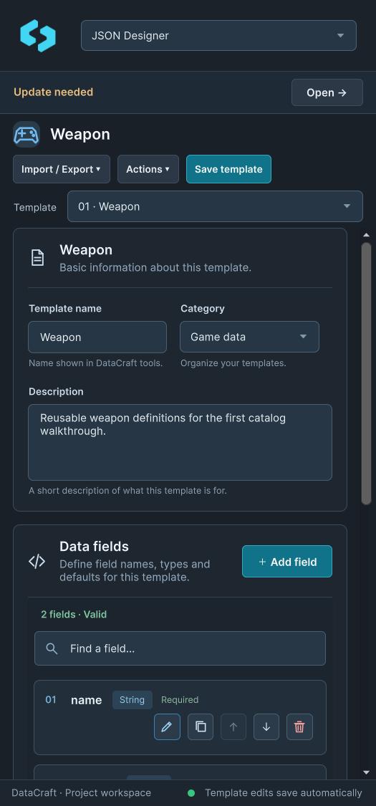
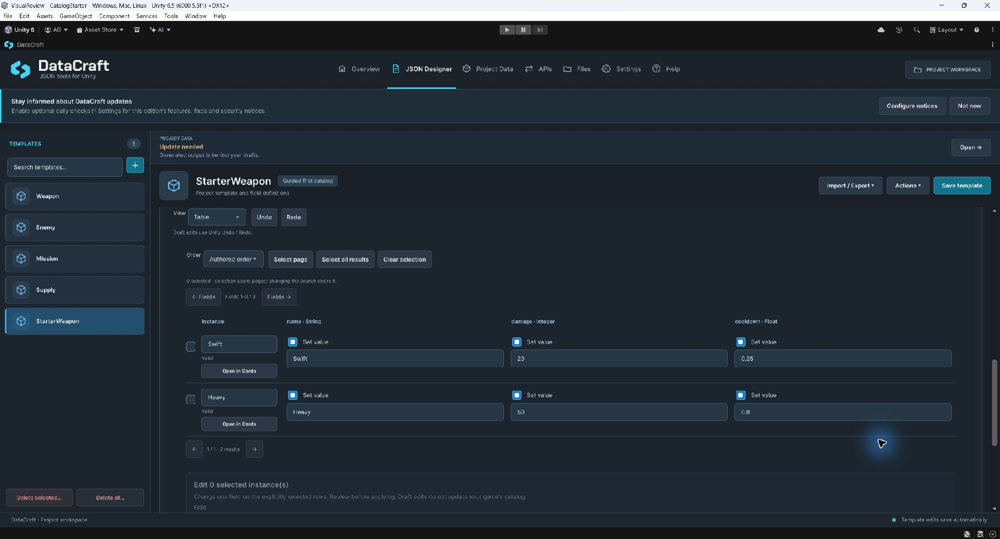
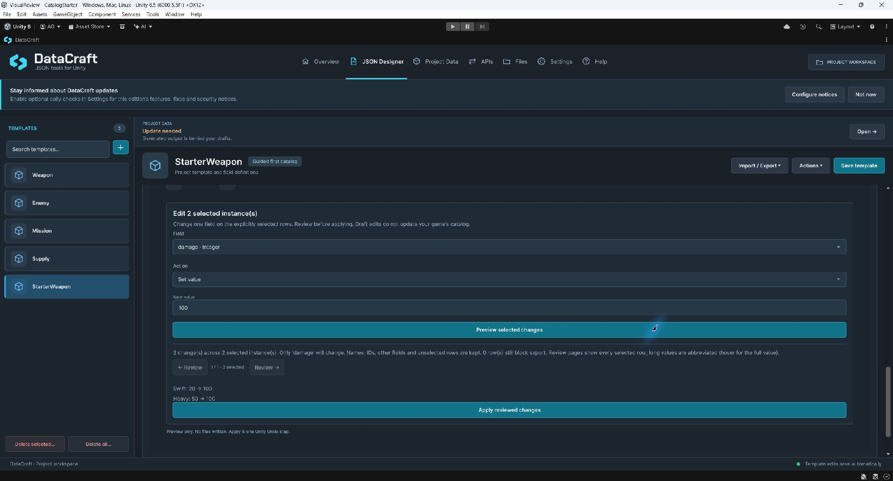

# Templates and instances

[Documentation home](index.md) · [First catalog walkthrough](UserGuide.md) · [Project Data](ProjectData.md)

A **template** defines fields. An **instance** is a named draft of values for those fields. JSON Designer saves both as project metadata; your game reads a separate generated catalog.

## Find and organize templates

Create a blank template with **+** or the empty-state action. Edit its name, category and description. Search by name. The list and selected header share a category icon. Narrow layouts use a template picker instead of the sidebar.

**Actions** groups duplication, Copy ID, reordering and schema review. Duplicate makes a new identity; rename/reorder retains the existing identity. Deleting a template does not silently delete its instance drafts. Review orphaned drafts on Project Data before explicitly removing them.

*The same workflow adapts to a docked window. Captured template names and counts are example project data.*

## Define fields

Use unique C#-style names: ASCII letter/underscore first, then letters, digits or underscores. Names are unique ignoring case; reserved C# keywords, including the special `__arglist`/`__makeref`/`__reftype`/`__refvalue` forms, are rejected. Field IDs stay stable when a name changes.

| Type | Values and rules |
| --- | --- |
| String | Text, including an explicitly set empty string |
| Integer | 32-bit integer |
| Float | Finite 32-bit value; use a dot decimal separator |
| Boolean | Set true/false; unset is a separate state |
| Enum | One named option with a stable Int32 code; no Flags |
| Template Reference | Stable link to an instance of the chosen target template |
| List | One ordered level of a supported scalar/Enum/reference type |

**Use default value** stores a default; it does not make a field Required. **Required when creating an instance** adds draft validation. Required Strings cannot be empty or whitespace-only. Required lists need at least one element. Defaults are copied for new bindings/instances; changing a default does not rewrite existing values.

### Enum options

Add named options, then choose a default if needed. Renaming/reordering preserves each option's numeric code. **Edit codes (advanced)** exposes numeric editing; use deliberate stable codes for game C# Enums. Removing an option leaves affected values unresolved until corrected. The name `value__` is reserved by C# for Enum storage and cannot be an option. There are at most 128 options, paged eight at a time.

### Lists and references

Lists preserve order and distinguish unset from explicit `[]`. They allow at most 1,024 elements and 1 MiB per list. Nested lists, null elements and arbitrary object lists are unsupported.

For a reference choose **Target template**, then a destination instance. Renaming/reordering keeps the link. Deleting a destination preserves the binding and reports an error. Changing the target does not convert old links automatically. Self-references/cycles are supported and resolve explicitly at runtime.

## Edit instance drafts

Choose **Instances → Create**, enter a unique instance name, then expand its row. **Set value** controls presence; enabling a Boolean's value is separate from setting it true. Search and pagination help with larger datasets. Clear a search before reordering; deletion requires confirmation. A single-instance template allows one draft.

Validation stays next to the affected values. You can retain incomplete drafts, but blocking errors prevent Project Data export. Bind a newly added field explicitly; a removed field's old binding remains stored until explicitly removed.

## Compare values in Table

Under **Instances**, choose **View → Table**. Cards remains available for full field descriptions, list-element editors and resolving changed field bindings. Table shows eight instances per page and one to three fields at a time, according to panel width; **Fields →** changes the visible columns without horizontal page scrolling. Narrow panels stack each row's fields under its identity. Each row shows its readiness and **Open in Cards**.

Names and text values commit with Enter or a focus change. **Set value** controls presence separately from a Boolean's **True** value; empty String, false and unset are distinct. Enums and references use their existing selectors. Table List values are complete JSON arrays; Cards offers the element editor. Numeric values use invariant notation (`1.5`). Invalid/incomplete drafts remain visible and still block export. Schema-changed bindings require resolution in Cards first.

**Order → Name A–Z / Name Z–A** sorts the view only; it does not reorder authored output. Clear the filter and use Cards to change authored ordering.

## Review a selected-row bulk edit

1. Select individual table rows, **Select page**, or **Select all results**. Selection can span pages; the count includes selected rows on other pages. Changing the search clears the selection. **Clear selection** starts again. A batch supports at most **1,024** explicitly selected instances of the current template.
2. Under **Edit selected instances**, choose one **Field** and **Set value** or **Unset value**. Enter/select the value and commit text with Enter or focus change.
3. **Preview selected changes** writes nothing. Review the total changed/selected counts, before/after values and rows that still block export. Review pages contain every selected row, twelve per page. Long values are abbreviated; hover for the full before/after value or inspect the instance in Cards.
4. **Apply reviewed changes** writes the reviewed draft batch as **one Unity Undo step**. It keeps IDs, instance names/order, other bindings and unselected rows. Setting a value on a newly added field explicitly binds that field. Changed binding types/targets must be resolved in Cards first.
5. Validate and explicitly update **Project Data** when ready. Draft edits, including Undo/Redo, do not publish the game's catalog.

Changing the selection, field, action or value discards the review. Changes to the schema, saved template file, draft graph or draft file make an old plan invalid; preview again. Invalid values for the edited field are rejected. Explicitly unsetting a Required field is allowed as an incomplete draft and is labelled as blocking export; existing unrelated errors remain visible. A no-change preview cannot be applied. Failed writes preserve the previous in-memory draft batch and report the reason.

See the [guided Catalog Starter](../examples/CatalogStarter/README.md) for a playable example of these steps.

## Review an existing schema change

1. Select the template and choose **Actions → Review schema changes**.
2. Inspect the bindings against the saved schema. Every choice begins as **Keep unchanged**.
3. Choose supported conversions, current-default resets, unset, binding new fields or explicit removal of obsolete values as appropriate. Lists/reference targets are not guessed.
4. Review selected changes, confirm and use **Apply with backup**. A schema/draft/file change invalidates an old review.
5. Correct remaining errors and explicitly update generated output.

Original draft bytes are retained under `ProjectSettings/DataCraftMigrationBackups`. This affects Editor drafts only, not player saves, API DTOs or generated game data. Review limits are 10,000 project instances, 10,000 bindings and 32 MiB drafts. There is no automatic backup pruning or crash/power-loss certification.

## Saving, Undo and recovery

Ordinary template and committed instance edits use Unity's native **Edit → Undo/Redo** in the current workspace session. Instance history covers create, edit/set/unset/bind/remove values, rename, duplicate, reorder, delete, instance-only import/update, draft schema review and table/bulk changes. **Undo / Redo** in the Instances toolbar uses the same global Unity history, which may also contain template, Inspector and scene edits. A focused text field can undo its uncommitted text first.

Instance history is scoped to the open workspace and is cleared on close or script reload. Template/library imports rebase the instance and template history so Undo cannot remove only half of a two-store import. Schema changes invalidate incompatible instance history; an unsafe Undo/Redo reports why and preserves current drafts. A saved draft file changed externally is not overwritten: reopen the workspace after reviewing the external changes. A read-only/failed write rolls back the in-memory mutation. Generated output, model/ID source files, endpoint assets, player saves and Files actions remain outside this instance history. Undo is not a durable backup or a crash journal; template recovery below is a separate feature.

If an ordinary template save fails, editing pauses and offers **Retry edit**, **Export recovery**, **Discard edit** and **Reload from disk**. Preserve a recovery export before closing when the journal cannot be written. Do not delete `Library` while template recovery is unresolved. See [Data locations and backups](DataAndBackups.md).

## Table and review in Unity

[Table in a narrow dock](Screenshots/table-authoring-docked.jpg). Fields page without horizontal workspace scrolling.

[Bulk review in a narrow dock](Screenshots/bulk-review-docked.jpg). Preview writes nothing; Apply is one native Undo step.

The searchable offline guide covers the same rules: [wide Help](Screenshots/table-help-wide.jpg), [docked Help](Screenshots/table-help-docked.jpg).
