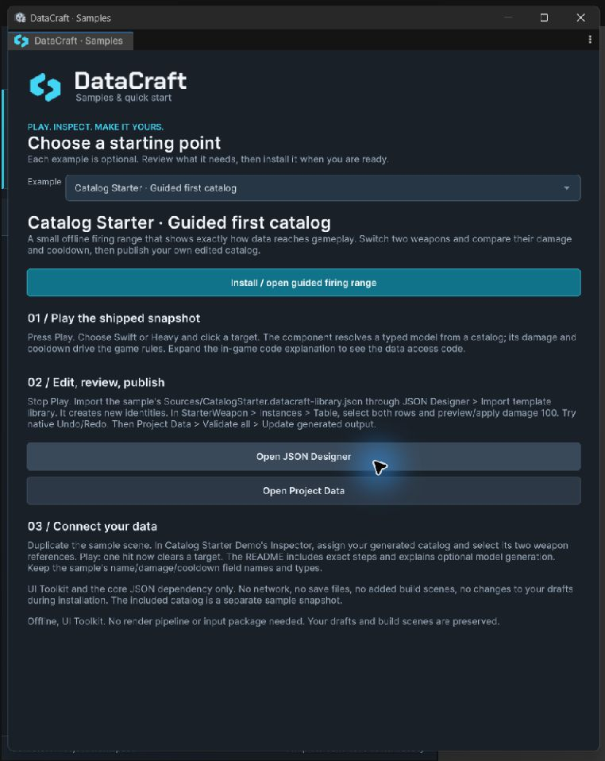
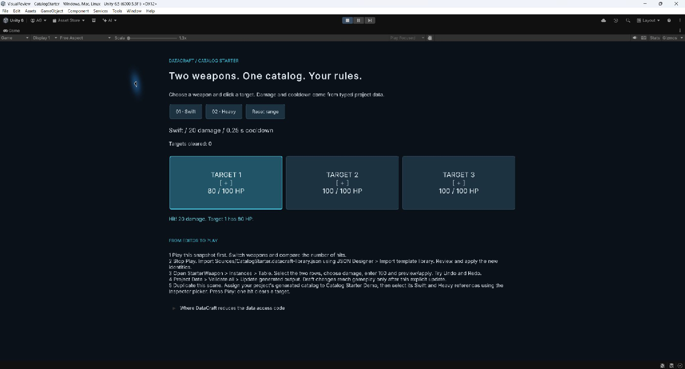

# Optional examples

[Documentation home](index.md) · [First catalog walkthrough](UserGuide.md)

Open **Tools → DataCraft → Samples and Quick Start**, or **Explore demos** on Overview. Stop Play Mode, select an example and follow its install/open action. Package Manager also exposes the sample sources; do not import multiple copies through different routes.

Core installation does not copy examples into Assets. Samples do not change project input, renderer or build settings automatically, and do not replace your templates/output. Back up modifications before importing another copy with shared GUIDs.

| Example | Learn | Additional requirements | Full walkthrough |
| --- | --- | --- | --- |
| **Catalog Starter** | Guided first catalog → table/bulk review → Undo/Redo → publish → playable firing range | UI Toolkit and core JSON only; fully offline | [Catalog Starter guide](../examples/CatalogStarter/README.md) |
| **Emberfall** | Catalog equipment, Enum/tags, Enemy → Weapon links and a local Save/Spend/Load checkpoint | Universal RP, Unity UI and Input System | [Emberfall guide](../examples/Emberfall/README.md) |
| **Stratus** | Weather JSON → DTO → a miniature observatory and graph | UI Toolkit; no Emberfall renderer/input requirements | [Stratus guide](../examples/WeatherStation/README.md) |
| **Helio** | Solar-event JSON → validated DTO → illustrative light/time preview | UI Toolkit | [Helio guide](../examples/Sunlight/README.md) |

## Start with the guided firing range

Catalog Starter is the initial choice in Samples. Install/open it, press Play and compare Swift and Heavy. Then follow its README: import its library with new IDs, bulk-edit damage in Table, try Undo/Redo, explicitly update Project Data and assign your catalog and references to a duplicate scene. One hit then clears a target. The included snapshot and your imported project drafts remain separate. The in-game code explanation shows where typed catalog access replaces manual reading/parsing/ID lookup; your component still implements the game rules.

## Start with offline data

Stratus and Helio start with clearly labelled synthetic/demo data. Live requests are explicit. They show failure/cancellation without replacing the last good state. External API availability, rate limits, CORS, attribution and commercial provider terms remain separate from your DataCraft license; read the sample's provider section before deployment.

Emberfall starts without writing a checkpoint. Save progress, change live values, then Load to see the distinction. Its sample catalog is independent of your project's generated output.

## Edit the sample's definitions

For Emberfall, import its Authoring Library through Designer's review. Imported identities are new. Generate your own catalog, duplicate the sample scene, then assign the new catalog and copied IDs as the walkthrough explains. The original sample snapshot remains unchanged.

For API samples, use **Open endpoint in APIs** to inspect their saved request configuration. Importing the response into a template is optional Editor content authoring, not a requirement for the runtime scene.

## Build an example

Keep referenced fonts, PanelSettings, shaders, endpoints and catalog assets. Add the intended scene to the build explicitly. Sample linker descriptors cover sample DTOs, not every game-owned DTO. Test your actual backend/stripping configuration. See [Compatibility](Compatibility.md) for exact tested Editors and the recorded URP limitation.

## Guided Catalog Starter in Unity

[Compact launcher](Screenshots/starter-launcher-compact.jpg). The three steps distinguish the shipped snapshot, your imported drafts and your published catalog.

[Game in a narrow dock](Screenshots/starter-game-docked.jpg). The game content scrolls vertically and target controls wrap with the available width.
