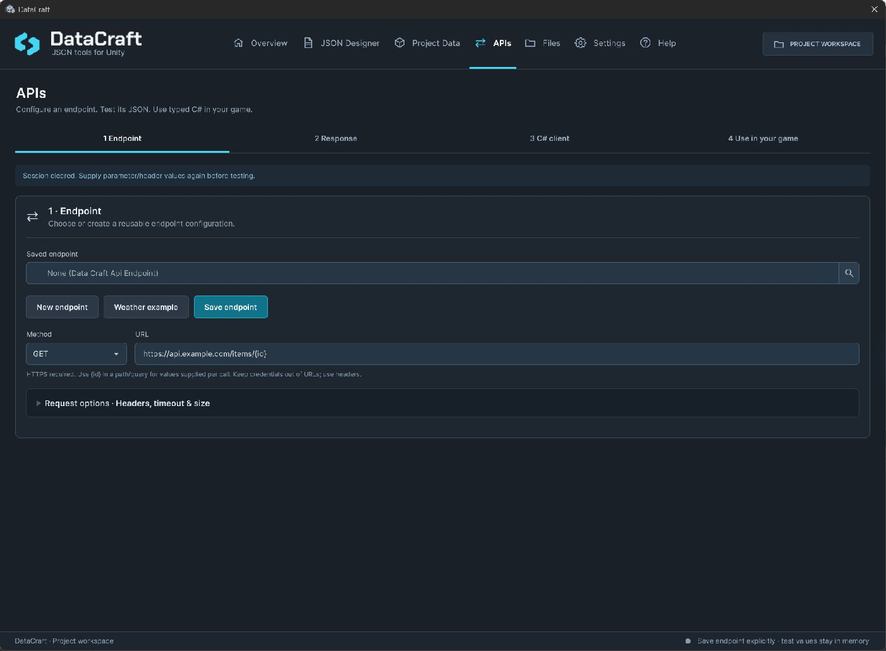
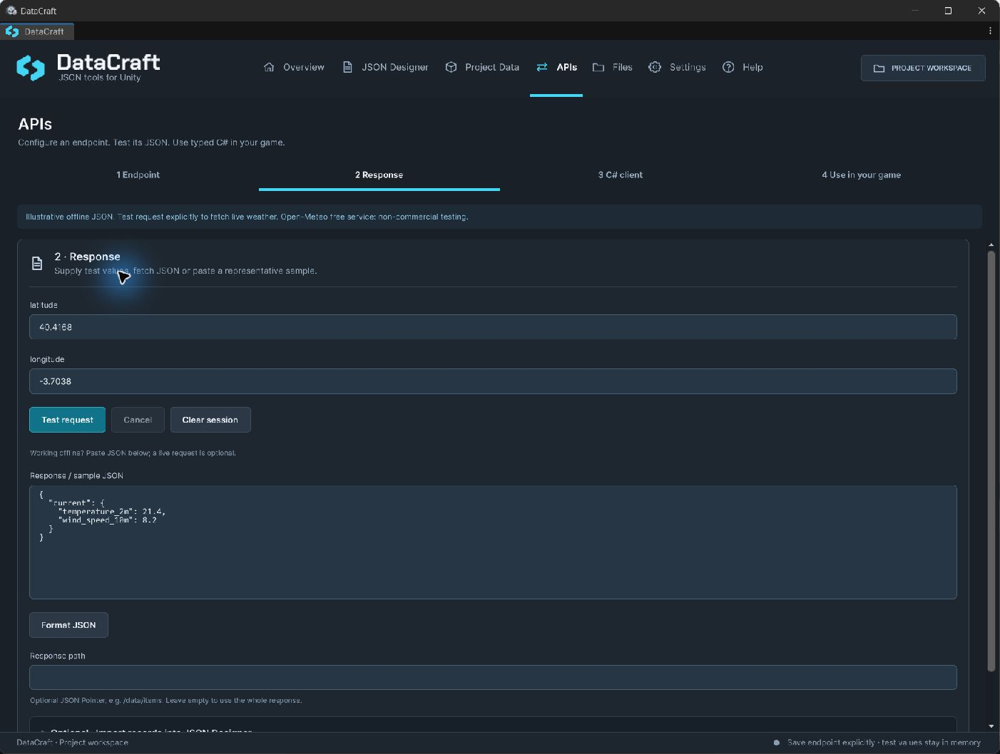

# HTTP JSON and generated clients

[Documentation home](index.md) · [API reference](ApiReference.md) · [Stratus and Helio examples](Examples.md)

Use **APIs** to configure a reusable endpoint, inspect ordinary JSON, review a typed client and optionally generate a gameplay component. No Designer template or catalog export is required.

## 1. Configure and save an endpoint

On **Endpoint**, choose/new an endpoint, set its HTTP method and fixed HTTPS URL, then **Save endpoint** to a game-owned asset. Use placeholders such as `{id}` in path/query values, after the fixed host. The endpoint stores header **names**, not secret values; supply values per session/runtime call.

Open **Request options · Headers, timeout & size** to review limits. Defaults are 15 seconds and 2 MiB. Keep credentials out of URLs, generated code and source control. A secret embedded in a client build can be extracted; use your own backend for server secrets.

## 2. Test or paste a response

On **Response**, supply test parameters/header values and explicitly test the request, or paste representative JSON offline. Opening an endpoint/page never makes a request automatically. Use a response JSON Pointer only when a nested subtree is your actual DTO root: empty selects the whole response, `/data/items` selects that member.

Test values stay in memory. Inspect status, response size and errors. Cancellation, deadline and body limits bound the request. HTTPS is required except supported loopback development; redirects are not followed automatically.

## 3. Review the C# client

On **C# client**, inspect inferred names/types and generate the DTO/static client to your game's chosen scripts folder. A single sample cannot prove every nullable/optional/polymorphic provider case. Check the provider's full schema and compile before use. Lists/dictionaries, nested objects, properties and JSON.NET attributes belong to this ordinary-JSON mapping workflow.

*Response and code previews use monospace text. The sample shown is an example, not a promise of every provider's response shape.*

Use `JsonProperty` for differing names and `Required.Always` only for genuinely mandatory members. Validate domain values before applying them to gameplay; preserve DTO constructors/members for reflection and the concrete generic instantiations needed by AOT/stripping.

## 4. Use it in your game

On **Use in your game**, review/generate the optional MonoBehaviour, attach it to an object and assign the saved endpoint. A generated static client is not a component. Invoke Fetch explicitly and adapt `ApplyResponse` to your game's behavior. Stratus and Helio show complete examples with loading, failure and cancellation feedback.

For a direct integration, `DataCraftApi.GetAsync<T>` performs a typed GET; `DataCraftApi.SendAsync<T>` accepts an explicit request; `endpoint.SendAsync<T>` applies saved configuration and its response path. [API reference](ApiReference.md) lists the entry points.

Tie cancellation to the intended object/request lifetime. Treat cancellation separately from `DataCraftApiException`; inspect its `Failure` and `StatusCode`. Keep the last successful gameplay state on failure and prevent out-of-order responses from overwriting newer state. Automatic retries, polling, pagination and OAuth refresh are not included in the generated workflow.

## Ordinary JSON versus saves/imports

`DataCraftRawJson.Deserialize<T>` maps ordinary external JSON. `DataCraftJson.Deserialize<T>` reads the DataCraft save envelope. Designer URL import acquires Editor authoring rows; it does not create a runtime API client. Saving fetched results is a separate game decision.

Browser CORS, provider authentication/rate limits, network availability and service terms still apply. A successful Editor request does not prove browser/device connectivity. Start offline with a representative response, then test authorized success/error/timeout/cancellation with your shipping backend.
