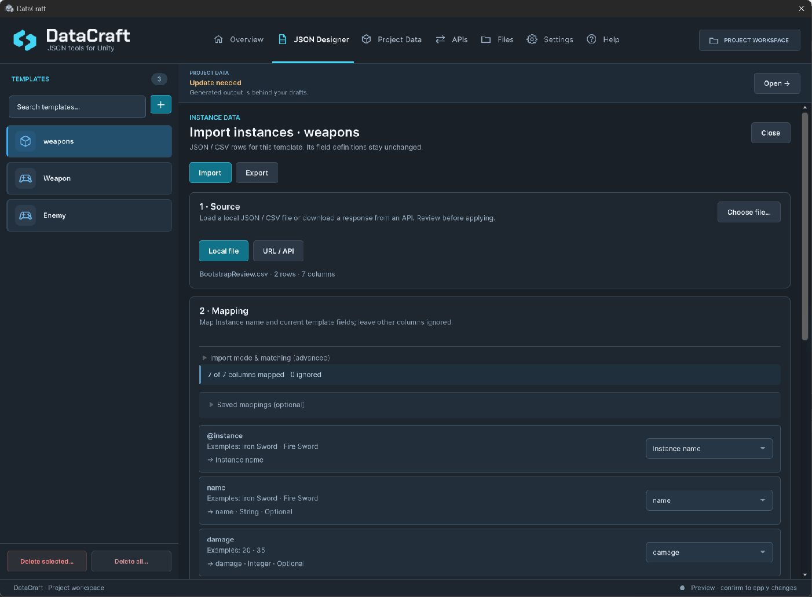

# Import and export

[Documentation home](index.md) · [Templates](Authoring.md) · [Project Data](ProjectData.md)

Open **JSON Designer → Import / Export**. Choose the operation by what you are moving, rather than by file extension alone.

| Goal | Operation | Result |
| --- | --- | --- |
| Start a schema from spreadsheet/JSON columns | Create template from JSON / CSV | Reviewed fields and optional new instances |
| Move one definition | Import/export template package | Fields and optional instances |
| Move linked templates together | Import/export template library | Multiple templates, optional instances and included relationships |
| Add/update rows using an existing schema | Import / Export instances (JSON / CSV) | Reviewed values; field definitions stay unchanged |
| Make drafts available to gameplay | Project Data output | Generated read-only catalog; not a transfer format |

Player save files use a separate envelope. Do not import them as template packages or use `DataCraft.Load` to open row-transfer JSON.

## Create a template from data

Choose a local JSON array of flat objects or comma-delimited CSV with a header. Review the inferred fields, names, types, Required/default options, metadata and instance naming. Choose template only or template plus rows before confirming.

Inference covers String, Integer, Float and Boolean. It does not invent Enum, List or reference schemas. Keep leading-zero identifiers and ambiguous columns as String. Acquisition limits are 8 MiB, 10,000 rows and 128 columns; unsupported nested values are not silently flattened. Files must contain valid UTF-8; JSON Unicode escapes need four hexadecimal digits and paired surrogates. Malformed text is rejected before import, including in ignored JSON branches.

## Import rows into a template

1. Define the destination fields first. Open **Import / Export instances (JSON / CSV) → Import**.
2. Choose a local file, or explicitly download a URL/API source. For a wrapped JSON array set **JSON collection**, such as `/data/weapons`, then apply it. Empty selects the root array.
3. Map a column to **Instance name** and map desired values to current fields. Check examples and the mapped/ignored count.
4. Review row diagnostics and previewed values. Errors block the entire import; warnings remain visible.
5. Confirm the reviewed operation. Closing/cancelling a preview writes nothing. Source/schema/draft changes can invalidate the plan; reload and review it again.



*The instance-transfer screen shares import/export navigation. The active mode and confirmation determine the operation.*

For a `Weapon` template with `name: String` and `damage: Integer`:

```json
[
  {"@instance":"Iron Sword","name":"Iron Sword","damage":15},
  {"@instance":"Fire Sword","name":"Fire Sword","damage":30}
]
```

Map `@instance` to Instance name. It is a display name, not a stable ID. Map `name` and `damage` to their matching fields. Ignored columns cannot satisfy Required fields.

## Preserve value meaning

- JSON missing/null mapped values become unset. Unmapped fields follow the applicable new/existing-instance policy.
- In DataCraft CSV, an unquoted empty cell is unset; quoted empty String `""` is explicitly empty. Spreadsheet software can normalize quoting: inspect the actual preview after re-saving.
- Integer-to-Float JSON mapping requires an exactly representable value (for example `16777216` is valid; `16777217` is rejected). Decimal/exponent Float values use finite 32-bit precision; values that underflow to zero are rejected.
- Enum values use exact, case-sensitive option **names**, not numeric codes.
- References use exact names of destination instances already present in the chosen target template; raw GUIDs and missing destinations are rejected.
- Lists use JSON arrays. In CSV the array is held in one correctly quoted cell. No nested lists or null elements.
- Collection paths are exact JSON Pointers: `/data/items`, zero-based array indexes, `~1` for `/`, `~0` for `~`. No wildcards or filters.

## Update existing rows by key

Under the advanced import options choose **Create new**, **Update existing**, or **Create or update**. Updates require a mapped String/Integer key field. It is an ordinary saved value, not an instance GUID or the display name.

String keys match exactly including case and must contain non-whitespace text (at most 256 characters, no controls). Integer keys are canonical Int32; zero is valid. Duplicate source/existing keys block the batch. Existing unset keys remain unmatched. Update existing rejects unknown keys; Create or update creates new identities for them.

Reviewed updates preserve matched IDs, order, inbound links and unmapped existing fields. Mapped missing/null values unset the binding. Defaults apply only to newly created instances. Rows absent from the source are never deleted. Saved mappings retain configuration, not credentials or a synchronized source feed.

## Move templates and relationships

Use a **template package** for one template or a **template library** for a linked set. Review metadata, field/value previews, warnings and dependencies. Library search only filters visibility; it does not change selection. Include required templates/destination instances before exporting a reference graph.

Imports create new identities and remap included links; they do not replace existing project templates, player saves or scene references. Preserve your original catalog/scene until you have assigned the imported IDs and explicitly generated new Project Data.

After any authoring import, open Project Data and update generated output explicitly when ready.
