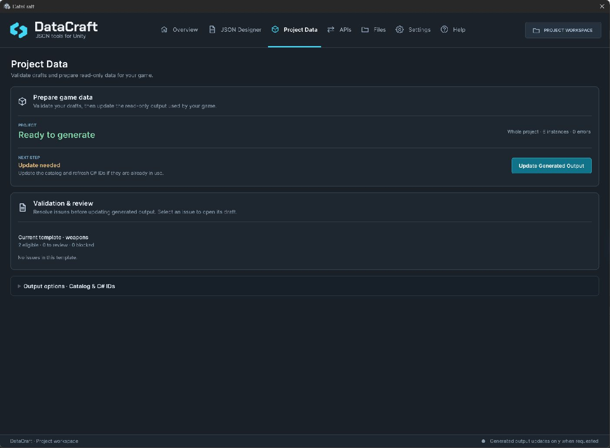

# Project Data and typed lookup

[Documentation home](index.md) · [First catalog walkthrough](UserGuide.md) · [API reference](ApiReference.md)

Project Data turns validated Editor drafts into a **read-only runtime snapshot**: a `DataCraftProjectCatalog` asset referencing JSON shards. Game-owned scene/prefab/asset references include it in a build. Export is explicit; editing drafts or DTOs does not refresh output.



## Understand readiness and output

| State | Next step |
| --- | --- |
| Blocking errors | Open the reported template/instance and correct the issue |
| Ready, not exported | Choose **Update Generated Output** or **Export Project Data** in Output options |
| Update needed | Choose **Update Generated Output** after reviewing drafts |
| Up to date | Assign/use the current catalog in game code |

Warnings/information remain reviewable. Errors block the project-wide export; no partial replacement is published. **Output options · Catalog & C# IDs** contains the independent output actions. The workspace writes the catalog to `Assets/DataCraftGenerated/ProjectData/DataCraftProjectCatalog.asset`, shards to its `Shards` folder and optional C# IDs to its `Code` folder. It does not prompt for a destination. **Select catalog** locates the created asset. Keep these generated files and their `.meta` files together; the workspace and build preflight inspect this location. C# IDs generate constants for real authored identities, not DTO or Enum declarations. Names that collide after conversion to C# symbols (including a template and its instance having the same name) receive stable ID suffixes; use the generated symbol rather than guessing it.

## Match your C# data to the schema

Use serializable non-generic classes/structs with matching reflected field names/types. Properties are not a substitute for those fields. Concrete DTO constructors/members used through reflection need appropriate preservation for the shipping backend/stripping level.

| Authored field | DTO field |
| --- | --- |
| String / Integer / Float / Boolean | `string` / `int` / `float` / `bool` |
| Enum | Int32-backed Enum with exact saved option names/codes; no Flags/aliases |
| Template Reference | `DataCraftTemplateReference` |
| List of a supported type | Exact single-level `List<T>` with the same element contract |

For saved options `Common (0)` and `Rare (10)`, declare `enum Rarity { Common = 0, Rare = 10 }`. Do not infer numeric codes from display order. Unset fields can retain DTO initializers; explicit empty lists replace them with a fresh empty collection.

## Query data and resolve links

```csharp
Weapon selected = catalog.Get<Weapon>(weaponTemplateId, weaponInstanceId);
System.Collections.Generic.IReadOnlyList<Weapon> all =
    catalog.GetAll<Weapon>(weaponTemplateId);
```

Copy real IDs in Designer or use generated C# constants. Names are display/mapping metadata, not lookup keys. `GetAll<T>` preserves saved instance order. Returned DTOs are fresh; modifying them does not edit the catalog or persist progress.

```csharp
// enemy.weapon is a DataCraftTemplateReference field in your Enemy DTO.
if (enemy.weapon.IsSet)
{
    Weapon weapon = enemy.weapon.Resolve<Weapon>(catalog);
}
```

A reference is a handle, not automatic recursive expansion. Importing a template package/library creates new IDs and remaps included relationships; update game-owned scene assignments and copied IDs explicitly.

## Handle errors and prepare builds

`DataCraftProjectDataNotFoundException` identifies missing data. `DataCraftProjectDataFormatException` identifies an invalid snapshot/shard. `DataCraftProjectDataMappingException` identifies an incompatible DTO. Invalid arguments are separate from those lookup failures. Correct the source/schema/reference rather than silently substituting a default weapon.

Build preflight checks existing project authoring for blocked, missing, stale, invalid or unreferenced generated output. It leaves Save/Load-only projects alone. Assign the actual catalog to a build-included game asset/scene; a reference sitting only in an Editor window does not include it in a Player.

Before shipping, build with your actual renderer, backend and stripping settings; test expected lookup, saved order, Enum/list values, reference resolution and an intentional missing-ID branch. See [Compatibility](Compatibility.md).
