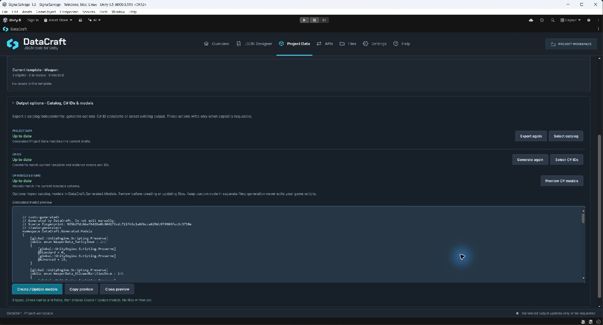
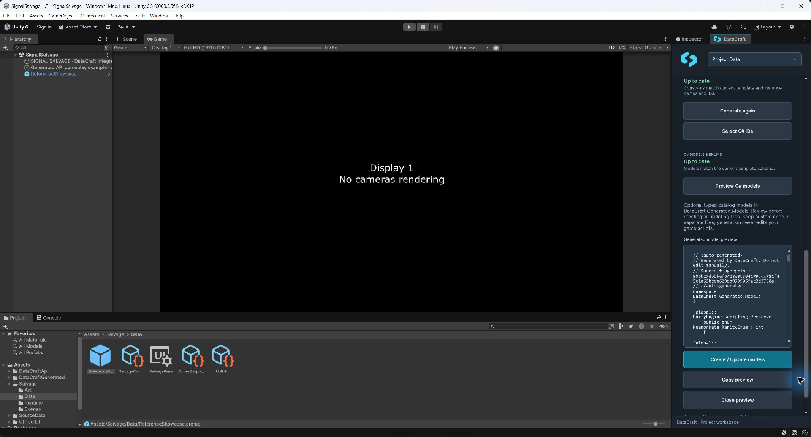
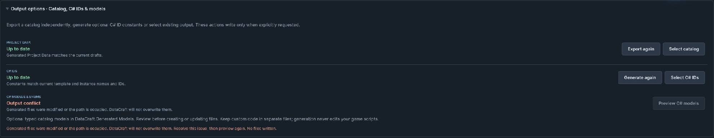
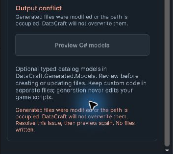
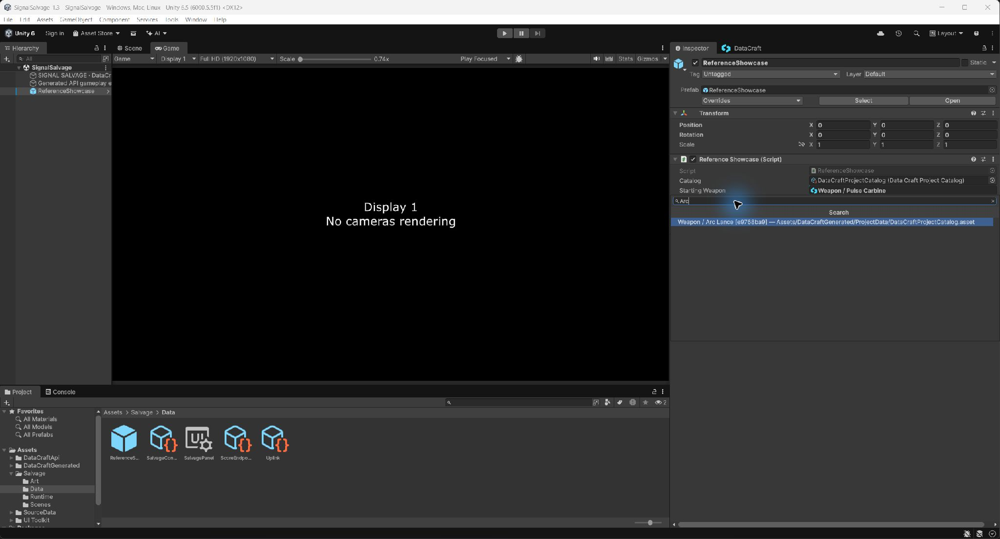
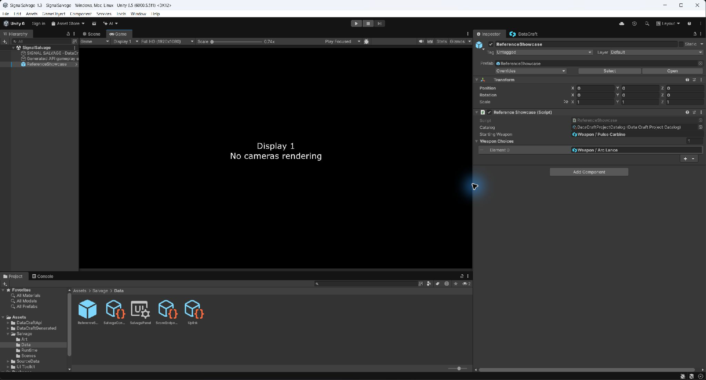
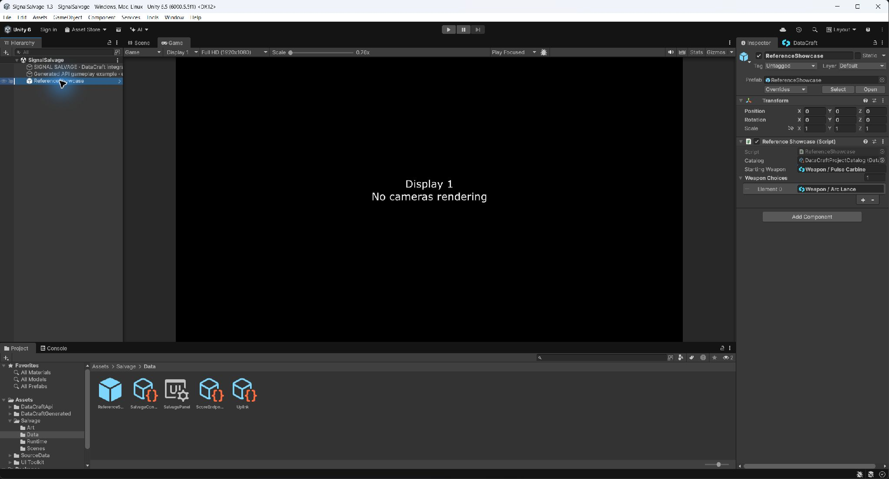

# Project Data and typed lookup

[Documentation home](index.md) · [First catalog walkthrough](UserGuide.md) · [API reference](ApiReference.md)

**Since 1.3.0:** optional model generation and named Inspector selection reduce the code needed to connect authored data to gameplay. Earlier manually maintained DTOs and ID lookups remain supported.

Project Data turns validated Editor drafts into a **read-only runtime snapshot**: a `DataCraftProjectCatalog` asset referencing JSON shards. Game-owned scene/prefab/asset references include it in a build. Export is explicit; editing drafts or DTOs does not refresh output.



*Captured from the separate Signal Salvage integration project. Your project lists only its own templates/instances.*

## Understand readiness and output

| State | Next step |
| --- | --- |
| Blocking errors | Open the reported template/instance and correct the issue |
| Ready, not exported | Choose **Update Generated Output** or **Export Project Data** in Output options |
| Update needed | Choose **Update Generated Output** after reviewing drafts |
| Up to date | Assign/use the current catalog in game code |

Warnings/information remain reviewable. Errors block the project-wide export; no partial replacement is published. **Output options · Catalog, C# IDs & models** contains the independent output actions. The workspace writes the catalog to `Assets/DataCraftGenerated/ProjectData/DataCraftProjectCatalog.asset`, shards to its `Shards` folder and optional C# IDs to its `Code` folder. It does not prompt for a destination. **Select catalog** locates the created asset. Keep these generated files and their `.meta` files together; the workspace and build preflight inspect this location. C# IDs generate constants for real authored identities, not DTO or Enum declarations. Names that collide after conversion to C# symbols (including a template and its instance having the same name) receive stable ID suffixes; use the generated symbol rather than guessing it.

## Generate C# models and Enums (optional)

1. Expand **Output options**, choose **Preview C# models**, and inspect the generated type/field names. This writes nothing.
2. Choose **Create / Update models** to write `Assets/DataCraftGenerated/ProjectData/Models/DataCraftModels.g.cs` and its `DataCraft.Generated.Models.asmdef` and owner manifest. Wait for Unity to compile.
3. Use `DataCraft.Generated.Models.WeaponData` for a template named Weapon. Inspect the preview for the actual name: display names are converted into C# type names and ambiguous names receive stable ID suffixes. Fields retain their exact authored names; each Enum retains every option name and numeric code, including gaps and negative codes.
4. Keep custom members in a separate partial file in the same generated assembly, for example `Models/WeaponData.Custom.cs`, with namespace `DataCraft.Generated.Models`. Do not edit `.g.cs`, its asmdef or owner manifest. Regeneration never edits other files and refuses changed/unowned output. Keep custom names distinct from authored fields. For broader behavior, a separate game service avoids partial-type renames.

Generation uses the **schema**, not the instance values or authored defaults. Unset members retain C# defaults (`null`, zero, false); explicit empty lists map to fresh empty collections. References remain handles, including circular references; no recursive object graph is generated. Generated classes, reflected fields and Enum values carry preservation attributes; still test your actual backend and generic calls in a Player.

A schema/name/order change makes models stale. Reopen the preview and explicitly update them. A preview made before a schema change cannot be applied. Value-only edits do not require model regeneration. **Update Generated Output** updates the catalog/opted-in IDs and opens model review when needed; it never silently accepts changed model code. Builds reject stale/conflicting opted-in model output. If renaming/deleting a template changes a type name, update game/partial-code references to that type; DataCraft does not rewrite user scripts. An optional model file is one managed source for all current templates, so deleting a template removes its generated declaration at the next explicit generation.

Custom assemblies need references to `DataCraft.Runtime` and `DataCraft.Generated.Models`; add `DataCraft.Generated` too when using the independent ID constants. Generated models do not depend on the ID assembly. Existing manual DTOs remain supported.



*The same model preview in Unity’s docked Inspector area; code uses the panel width and actions stay reachable by vertical scrolling.*

### Resolve an output conflict

A conflict discards the reviewed preview and disables generation. After restoring a valid snapshot, reopen Project Data and preview again before generating. No files are written by this recovery step.





Keep a backup or version-control copy of the complete Models folder, including `.meta` files. A modified/missing managed file, or another asmdef/asmref in that exact folder, blocks generation and is not repaired automatically. Restore the three managed files from a known-good generated snapshot, preserving their `.meta` GUIDs, and move intended custom logic into separate partial/game files. Do not change checksum values to force ownership. LF/CRLF conversion alone does not invalidate ownership; other content edits still do. An unrelated manual assembly does not opt your project into model generation. If the folder contains unrelated code/assembly files, resolve their assembly/namespace layout first, then preview again. Compiler errors after a deliberate type rename are fixed in your game/custom partial references; the generator does not rewrite them.

## Select a reference in the Inspector

Reference labels and input slots use Unity’s native aligned Inspector field layout, including list rows, without a hand-calculated label column. Reference fields use Unity’s standard object-field appearance with a small cyan DataCraft symbol inside the selector. Unity’s own blue prefab-override markers still appear when an instance differs from its prefab, as for other serialized fields.

Declare `[SerializeField] private DataCraftTemplateReference weapon;` on a game component and assign its catalog separately. Open the reference dropdown, search the exported instance name and choose its row. Each row identifies its template, ID prefix and catalog path to disambiguate duplicates. **None (clear reference)** clears it explicitly. New/unexported drafts are absent until Project Data is exported. The picker includes available catalog assets, including optional samples; it does not add a catalog reference to your component or automatically include it in your build.



*Signal Salvage’s Weapon choices identify the source catalog and stable instance ID. This example does not add those weapons to your project.*

Renaming an instance keeps the stored IDs; after export its label updates. Missing/deleted targets show **Missing reference** and retain their IDs until you explicitly replace or clear them. Invalid catalogs show unavailable diagnostics. Multi-object edits, reference list elements, prefab overrides and Unity Undo use normal serialized Inspector editing. List rows keep stable Element 0, Element 1 labels instead of showing internal template IDs. Inspector selection is Editor-only; runtime resolution still requires `reference.Resolve<T>(catalog)` with the correct catalog/DTO.

Optionally use `[DataCraftReferenceTarget(DataCraftIds.Templates.Weapon)]` (requires generated IDs), or a real stable template-ID string, to limit choices. Generated reference fields carry this attribute automatically. The attribute constrains Inspector selection, not runtime validation; it does not change stored IDs. A mismatched existing handle is shown as **Wrong template** until explicitly changed.

## Match your own C# data to the schema

Use serializable non-generic classes/structs with matching reflected field names/types. Properties are not a substitute for those fields. Concrete DTO constructors/members used through reflection need appropriate preservation for the shipping backend/stripping level.

| Authored field | DTO field |
| --- | --- |
| String / Integer / Float / Boolean | `string` / `int` / `float` / `bool` |
| Enum | Int32-backed Enum with exact saved option names/codes; no Flags/aliases |
| Template Reference | `DataCraftTemplateReference` |
| List of a supported type | Exact single-level `List<T>` with the same element contract |

For saved options `Common (0)` and `Rare (10)`, declare `enum Rarity { Common = 0, Rare = 10 }`. Do not infer numeric codes from display order. Unset fields can retain DTO initializers; explicit empty lists replace them with a fresh empty collection.

## Query data and resolve links

```csharp
Weapon selected = catalog.Get<Weapon>(weaponTemplateId, weaponInstanceId);
System.Collections.Generic.IReadOnlyList<Weapon> all =
    catalog.GetAll<Weapon>(weaponTemplateId);
```

Copy real IDs in Designer or use generated C# constants. Names are display/mapping metadata, not lookup keys. `GetAll<T>` preserves saved instance order. Returned DTOs are fresh; modifying them does not edit the catalog or persist progress.

```csharp
// enemy.weapon is a DataCraftTemplateReference field in your Enemy DTO.
if (enemy.weapon.IsSet)
{
    Weapon weapon = enemy.weapon.Resolve<Weapon>(catalog);
}
```

A reference is a handle, not automatic recursive expansion. Importing a template package/library creates new IDs and remaps included relationships; update game-owned scene assignments and copied IDs explicitly.

## Handle errors and prepare builds

`DataCraftProjectDataNotFoundException` identifies missing data. `DataCraftProjectDataFormatException` identifies an invalid snapshot/shard. `DataCraftProjectDataMappingException` identifies an incompatible DTO. Invalid arguments are separate from those lookup failures. Correct the source/schema/reference rather than silently substituting a default weapon.

Build preflight checks existing project authoring for blocked, missing, stale, invalid or unreferenced generated output. It leaves Save/Load-only projects alone. Assign the actual catalog to a build-included game asset/scene; a reference sitting only in an Editor window does not include it in a Player.

Before shipping, build with your actual renderer, backend and stripping settings; test expected lookup, saved order, Enum/list values, reference resolution and an intentional missing-ID branch. See [Compatibility](Compatibility.md).




