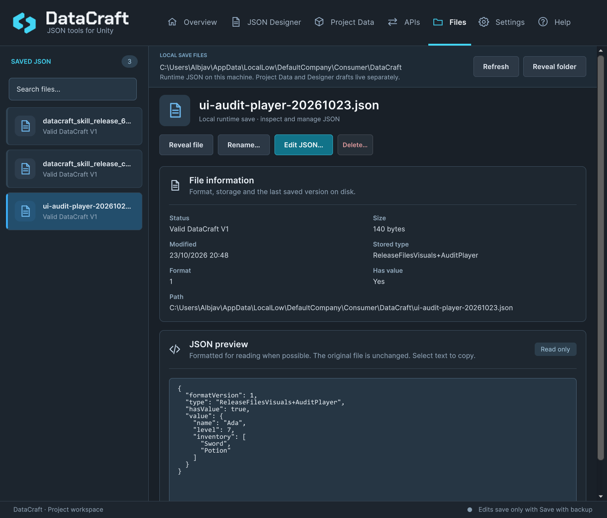

# Local saves and Files

[Documentation home](index.md) · [API reference](ApiReference.md) · [Data and backups](DataAndBackups.md)

Use local saves for mutable player progress. Use [Project Data](ProjectData.md) for read-only definitions. A save can store a weapon's stable ID plus player state rather than a copy of its entire definition.

## Save and load progress

Create `ProgressStore.cs` in your game:

```csharp
using System;
using System.IO;
using Storage = DataCraft.DataCraft;

public static class ProgressStore
{
    [Serializable]
    public sealed class Progress
    {
        public int coins;
        public string checkpoint;
    }

    public static void Save(Progress progress) => Storage.Save("player", progress);

    public static Progress LoadOrCreate()
    {
        try { return Storage.Load<Progress>("player"); }
        catch (FileNotFoundException) { return new Progress(); }
    }
}
```

Call `ProgressStore.Save` at your chosen checkpoint; call `LoadOrCreate` when starting/resuming. Invalid or inaccessible existing files remain errors for your game's recovery UI. Do not overwrite a damaged file with defaults in a broad catch.

Names are logical names **without `.json`**. Separators, traversal, invalid/reserved names and trailing dots/spaces are rejected. `Storage.GetPath("player")` returns the actual filename under `Application.persistentDataPath/DataCraft`.

`Save` uses Unity-serializable data: serializable classes/structs and supported fields, not arbitrary dictionaries/properties or polymorphic roots. Load with the exact declared root type used to save. JSON.NET attributes belong to the external-JSON workflow and do not change the save serializer.

## Inspect files in the Editor



*Files shows this Editor/project environment's saves. The example path and filename come from an isolated capture project.*

Search/select a save, or use **Saved JSON** in compact layouts. **Refresh** reloads external changes; **Reveal folder/file** opens its location. Browsing a missing folder does not create it. The read-only preview does not rewrite source JSON.

**Valid DataCraft V1** means the envelope is recognizable; it does not validate your game's entire DTO. Foreign/invalid/unsupported/unreadable/oversized files remain visible with context. Editor and Player/device storage can differ; Files does not browse a connected device.

## Review edits and destructive actions

| Action | Review and boundary |
| --- | --- |
| Edit JSON | Complete valid UTF-8 JSON up to 64 KiB; **Save with backup** preserves original bytes under `.backups` |
| Rename | Logical name without `.json`; no overwrite; update game code that uses the old name |
| Delete | Explicit confirmation; permanent, no Undo or automatic backup; readable files up to 2 MiB |

An external change invalidates an inspected snapshot: cancel/refresh and review again. Read-only/linked paths are refused for controlled operations. Unsaved text must be saved or discarded before changing files and does not survive closing/reloading. Backups are not automatically pruned/restored. Failed operations preserve the original or report the retained recovery path.

## Handle runtime failures deliberately

`FileNotFoundException` is a possible first-run/new-slot condition. `InvalidCastException` means the declared root type differs. `FormatException` means the JSON/envelope is invalid or unsupported. Filesystem/permission failures must be surfaced separately. `Save(..., overwrite: false)` raises `IOException` when the file exists.

`Exists` is a convenience, not a lock against another writer. Use one game-owned save coordinator where concurrency matters. Atomic replacement helps handled failures; it is not certification against every crash or power loss. Saves are plain JSON: no cloud storage, encryption or anti-cheat is provided.

Your game owns DTO/schema migrations. Keep original bytes and validate converted state before deliberate replacement. Designer's schema review migrates Editor drafts, not player save files.

Before shipping, test Save → change in memory → Load, then a cold restart under the same app identity. For Web, configure and test [browser persistence](WebPersistence.md); returning from Save does not prove an asynchronous browser commit has finished.
