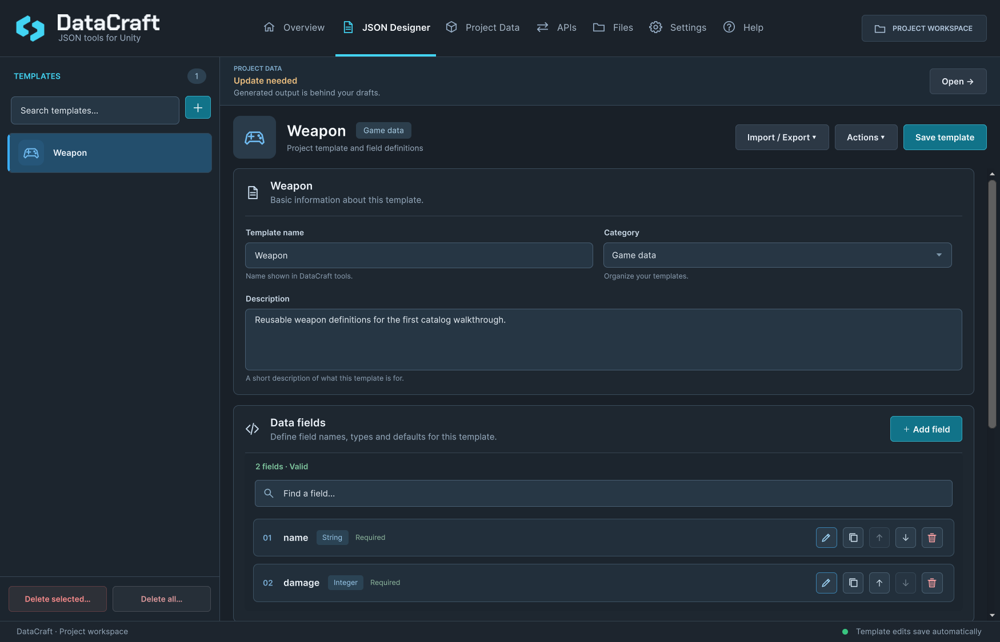

# Your first game data

[Documentation home](index.md) · Next: [Templates and instances](Authoring.md)

This walkthrough creates two weapons and reads one from a generated catalog in Play Mode. You need an [installed package](../INSTALLATION.md) and a scene. No account or network request is needed.

## 1. Create a template

Open **Tools → DataCraft → Open DataCraft**, then **JSON Designer**. Use **+** or **Create blank template**, depending on the layout. Name the template `Weapon`.

Add two fields with these exact names and types:

| Name | Type | Required | Default |
| --- | --- | --- | --- |
| `name` | String | On | Leave disabled |
| `damage` | Integer | On | Leave disabled |

Template edits save automatically. Categories organize the list by icon; they do not change the schema.



*The captured example matches this walkthrough: `Weapon`, with Required `name` and `damage` fields. The category/description are optional organizational metadata.*

## 2. Create instance drafts

In the template's **Instances** area choose **Create**. Name the first instance `Iron Sword`; set `name` to `Iron Sword` and `damage` to `15`. Create `Fire Sword` with `name` = `Fire Sword` and `damage` = `30`.

Enable **Set value** where needed. Zero, false, empty text and unset are distinct states. Resolve the Required warnings before continuing. Instance edits save automatically as Editor drafts.

## 3. Publish the catalog

Open **Project Data**. Review any validation issues and choose **Update Generated Output**, or the initial export action under **Output options · Catalog & C# IDs**. The workspace writes to **`Assets/DataCraftGenerated/ProjectData`** automatically; there is no destination dialog. Wait for the export to finish. Expand **Output options · Catalog & C# IDs** and choose **Select catalog**, or find `DataCraftProjectCatalog.asset` in that folder in the Project window.


*Readiness means the drafts can be exported. The output status tells you whether the generated snapshot is current.*

Select the generated `DataCraftProjectCatalog` asset. In Designer use **Actions → Copy ID** for `Weapon`, and the instance row's **ID** action for `Iron Sword`. Copy the real IDs; do not use names or invent GUIDs.

## 4. Read the weapon in Play Mode

In the Project window create `Assets/Game/WeaponReader.cs` (create the `Game` folder if needed), replace its contents with the following code and wait for compilation. In the Hierarchy create an empty GameObject and add **WeaponReader** with **Add Component**. Drag `Assets/DataCraftGenerated/ProjectData/DataCraftProjectCatalog.asset` into its **Catalog** field, then paste the copied Weapon and Iron Sword IDs into **Template Id** and **Instance Id**.

```csharp
using System;
using DataCraft;
using UnityEngine;
using UnityEngine.Scripting;

public sealed class WeaponReader : MonoBehaviour
{
    [Serializable, Preserve]
    public sealed class Weapon
    {
        [Preserve] public string name;
        [Preserve] public int damage;
    }

    [SerializeField] private DataCraftProjectCatalog catalog;
    [SerializeField] private string templateId;
    [SerializeField] private string instanceId;

    private void Start()
    {
        if (catalog == null)
        {
            Debug.LogError("Assign the generated DataCraft catalog.");
            return;
        }
        Weapon weapon = catalog.Get<Weapon>(templateId, instanceId);
        Debug.Log($"{weapon.name}: {weapon.damage}");
    }
}
```

Press Play. The expected Console message is **`Iron Sword: 15`**. A missing ID or schema mismatch raises a specific lookup error; use the [Project Data guide](ProjectData.md) to diagnose it.

## 5. Make a change and see the snapshot boundary

Stop Play, change Iron Sword's draft damage to `20`, then open Project Data. It should report that output needs updating. Choose **Update Generated Output**, then enter Play again: the message becomes **`Iron Sword: 20`**.

Without that explicit update, the catalog retains the previous snapshot. Build preflight catches missing, stale, invalid or unreferenced project output; keep the scene's catalog reference and include that scene in your build.

You now have reusable definitions. For coins/checkpoints or an equipped weapon ID, follow [Local saves](SavesAndFiles.md). For Enums, lists and linked enemies, continue with [Templates](Authoring.md) and [Project Data](ProjectData.md), or play [Emberfall](Examples.md).
