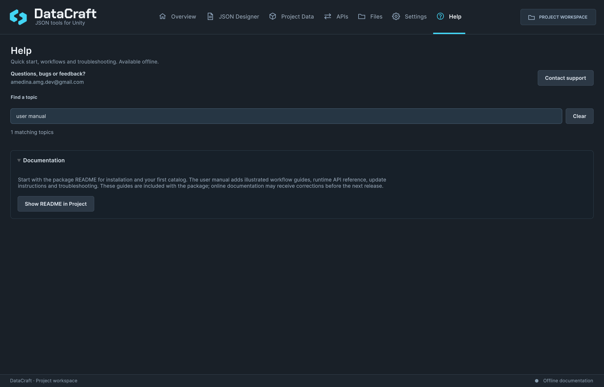

# DataCraft user documentation

**New to DataCraft?** [Install the package](../INSTALLATION.md), then [create your first catalog](UserGuide.md). If your game only needs local saves or an API, go directly to that guide.

## Learn the workflows

| Guide | What you will learn |
| --- | --- |
| [Your first game data](UserGuide.md) | Create two weapons, export a catalog and read it in Play Mode |
| [Templates and instances](Authoring.md) | Field types, defaults, validation, stable identities and schema changes |
| [Project Data](ProjectData.md) | Publish read-only output, match DTOs, resolve references and prepare builds |
| [Import and export](ImportExport.md) | Choose the right transfer format, map rows and review keyed updates |
| [Local saves and Files](SavesAndFiles.md) | Save progress, handle failures and inspect local JSON safely |
| [HTTP JSON](HttpApi.md) | Test an endpoint, review C# output and manage request lifetimes |
| [Optional examples](Examples.md) | Choose Emberfall, Stratus or Helio and follow its walkthrough |
| [Settings and AI integration](SettingsAndAI.md) | Preferences, version details and optional assistant instructions |
| [Updates](Updates.md) | Update through your purchase store, understand notices and restore a package |

## Reference and recovery

- [Runtime API reference](ApiReference.md)
- [Data locations and backups](DataAndBackups.md)
- [Troubleshooting](Troubleshooting.md)
- [Compatibility and tested boundaries](Compatibility.md)
- [Web persistence](WebPersistence.md)
- [Release notes](../CHANGELOG.md)
- [Contact support](../SUPPORT.md)

Help inside Unity covers the same workflows offline. Images in these guides are real Unity captures; sample names/counts depend on the capture project. Any simulated update state is labelled as such and is not a live release or security advisory.

## Help inside Unity

*Search for a topic in Help, or select the package README to begin the illustrated guides. This is the real Unity view of the next documentation revision. [Compact layout](Screenshots/docs-help-compact.png).*
